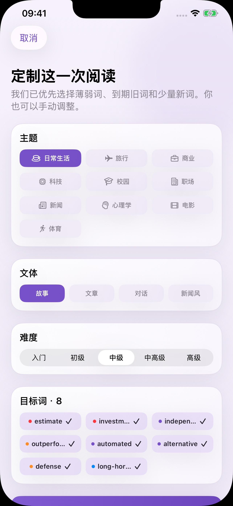
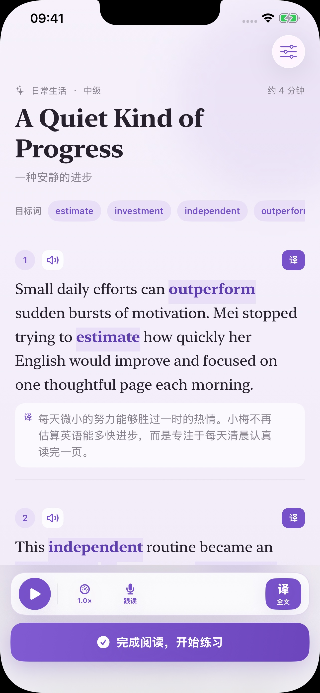
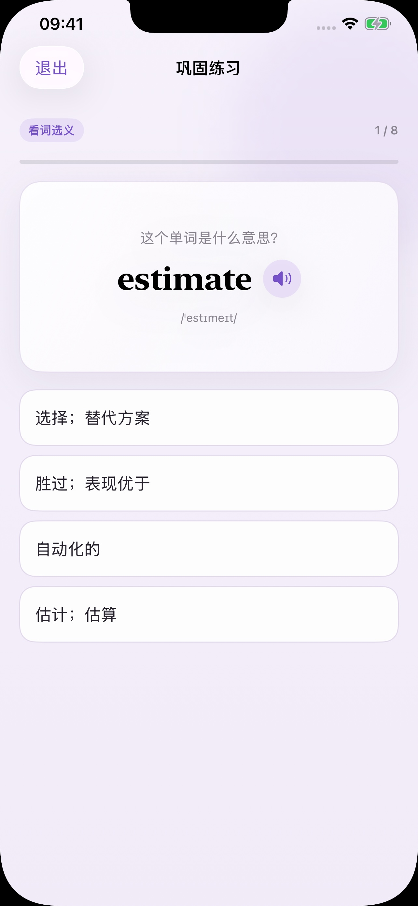
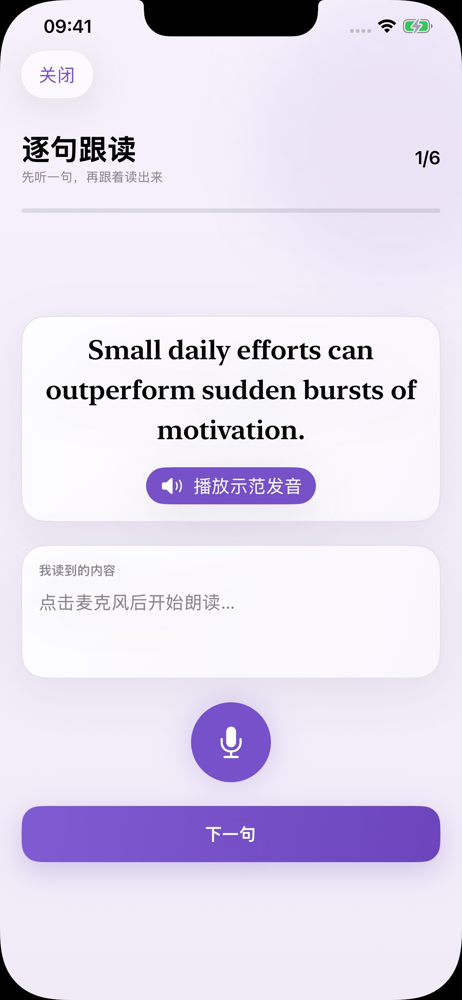
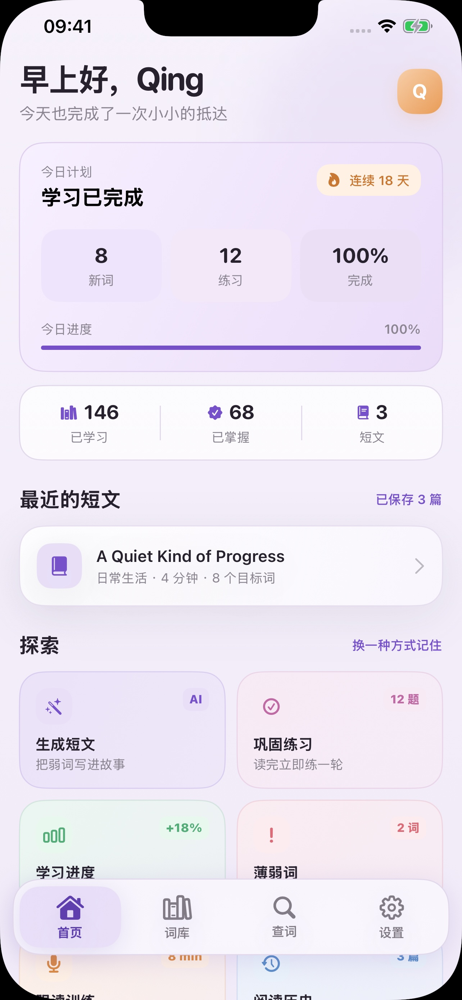
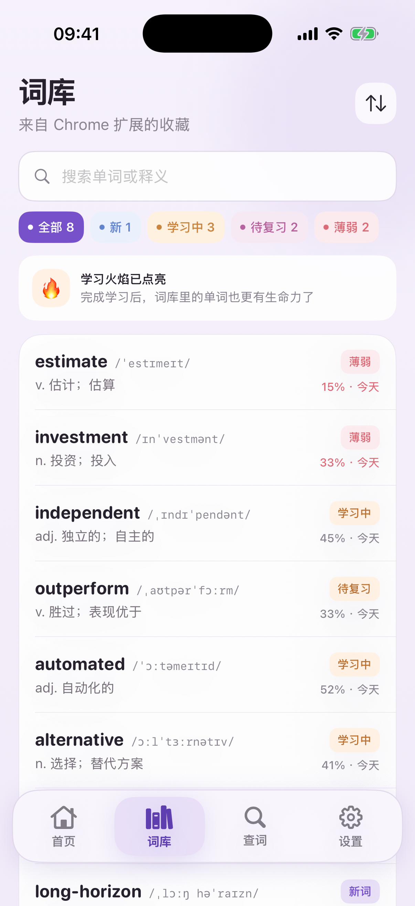
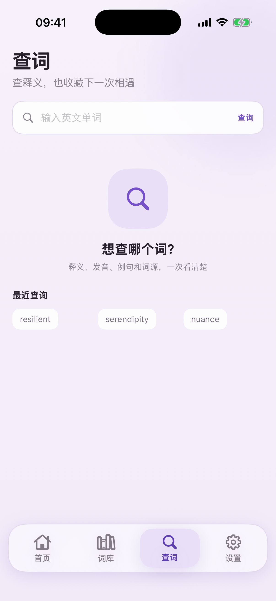
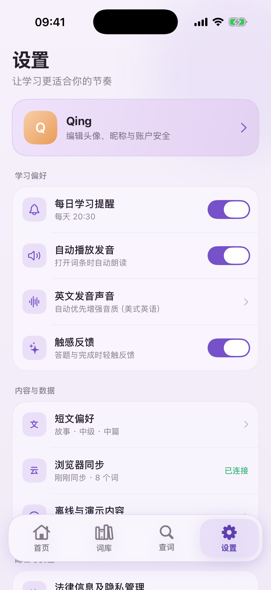

# CiJing · Learn Words in Context

<p align="center">
  
</p>

<p align="center">
  Start with words you meet in real reading, then connect their context, reading, practice, and review into a learning loop that lasts.
</p>

<p align="center">
  <a href="https://apps.apple.com/cn/iphone/search?term=%E8%AF%8D%E9%B2%B8%E8%83%8C%E5%8D%95%E8%AF%8D">Find CiJing on the App Store</a> ·
  <a href="https://chromewebstore.google.com/detail/%E8%AF%8D%E9%B2%B8%E8%83%8C%E5%8D%95%E8%AF%8D/afihhehkmefgcknloikpejfpikcddifn">Install the Chrome extension</a> ·
  <a href="https://github.com/KapiYue/huoci">HuoCi WeChat Mini Program</a> ·
  <a href="README_zh.md">简体中文</a>
</p>

<p align="center">
  
  
  
  
  
</p>

## Product demo

<table>
  <tr>
    <td width="50%" align="center" valign="top">
      <a href="https://youtu.be/H4Yp9_9SJho">
        
      </a>
      <br><br>
      <strong>Full product walkthrough</strong>
      <br>
      <sub>Capture words → AI graded reading → reading practice → spaced review</sub>
      <br><br>
      <a href="https://youtu.be/H4Yp9_9SJho">▶ Watch the YouTube walkthrough</a>
    </td>
    <td width="50%" align="center" valign="top">
      <a href="https://chromewebstore.google.com/detail/%E8%AF%8D%E9%B2%B8%E8%83%8C%E5%8D%95%E8%AF%8D/afihhehkmefgcknloikpejfpikcddifn">
        
      </a>
      <br><br>
      <strong>CiJing Chrome extension</strong>
      <br>
      <sub>Double-click lookup → preserve sentence and source → save once → continue in CiJing</sub>
      <br><br>
      <a href="https://chromewebstore.google.com/detail/%E8%AF%8D%E9%B2%B8%E8%83%8C%E5%8D%95%E8%AF%8D/afihhehkmefgcknloikpejfpikcddifn">▶ Install from Chrome Web Store</a>
    </td>
  </tr>
</table>

## Why CiJing exists

Vocabulary study is often separated from real reading: looked-up words disappear into search history, their original sentences are forgotten, and saving, practice, and review live in different tools. CiJing connects the meaningful actions that follow meeting a word: understand it in context, save it, bring it into readable content, and meet it again at the right time.

## What it delivers

| CiJing iOS app | CiJing Chrome extension | HuoCi WeChat Mini Program |
| --- | --- | --- |
| Personal vocabulary library, AI graded readings, reading practice, sentence shadowing, and progress. | Double-click lookup in the current web context, pronunciation, and saving a word with its source. | A lighter entry point for daily study in WeChat; search for “活词” to use it. |

The three entry points share core vocabulary data, context, and review foundations, while each keeps screens and learning orchestration designed for its setting.

## Core experience

| 1. Understand in context | 2. Save the source | 3. Bring words into a story | 4. Retain through practice |
| --- | --- | --- | --- |
| Double-click on the web or look up in the app to see definitions, phonetics, pronunciation, and examples. | Save the first sentence, webpage source, and your own notes. | Choose from new, weak, and due words to create a coherent bilingual, graded story. | Complete meaning, contextual cloze, active recall, and spelling tasks; results guide later review. |

<p align="center">
  
  
  
  
</p>

## Interface and modules

| Home | Library | Lookup | Settings |
| --- | --- | --- | --- |
| Daily plan, accumulated progress, saved readings, and a way back into learning. | Learning states, strength, due dates, and each word's context. | Definitions, pronunciation, examples, and one-tap saving. | Learning preferences, privacy, cache, and account controls. |
|  |  |  |  |

## Interoperable across products, without forcing one product shape

[HuoCi](https://github.com/KapiYue/huoci) is CiJing's WeChat Mini Program companion. It shares core vocabulary data, context, and review foundations with CiJing, while keeping its own onboarding, daily learning flow, and product states for the Mini Program.

```text
CiJing iOS app ────────┐
CiJing Chrome extension ┼── Shared account, vocabulary facts, context, and review foundations ── Supabase
HuoCi WeChat Mini Program ┘

Each product owns its own screens, learning queue, product metrics, and interaction rhythm.
```

This lets you collect real words while reading at your computer, study them deeply on iPhone, and use HuoCi as a lighter daily entry point in WeChat.

## Repository layout

```text
.
├── client/      # SwiftUI iOS app
├── extension/   # Published Chrome lookup and saving extension
├── supabase/    # Shared data model, RLS, RPCs, and Edge Functions
├── server/      # Trusted Flask boundary and health checks
├── scripts/     # Configuration, auditing, and automated checks
├── docs/        # Public documentation, screenshots, and demo assets
└── website/     # Privacy policy and support pages
```

The HuoCi Mini Program, cross-product shared types, and Mini Program-specific logic live in the separate [huoci](https://github.com/KapiYue/huoci) repository.

## Run locally

You need macOS, Xcode 16+, Node.js 20+, Docker Desktop, and Chrome. Copy the environment template, generate the client configuration, then start local Supabase:

```bash
cp .env.example .env
# Fill the environment values in .env
make config

./scripts/supabase.sh start
./scripts/supabase.sh db reset
make functions
```

Open `client/CiJing.xcodeproj` in Xcode, select the `CiJing` scheme and an iOS 17+ simulator, then run. For the development extension, open `chrome://extensions`, enable developer mode, and load `extension/` unpacked.

## Verification and developer documentation

```bash
make config-check
make extension-test
make server-test
make ios-build
```

Implementation, database, and release detail lives in the component documentation:

- [Supabase architecture, local development, and production operations](supabase/README.md)
- [Trusted Flask server](server/README.md)
- [Contributing](CONTRIBUTING.md)
- [Privacy policy](docs/privacy-policy.md), [terms](docs/terms-of-service.md), and [support](docs/support.md)

This project is available under the [MIT License](LICENSE). Please report vulnerabilities privately through [SECURITY.md](SECURITY.md).
