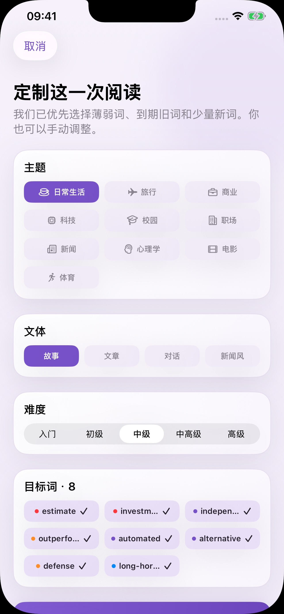
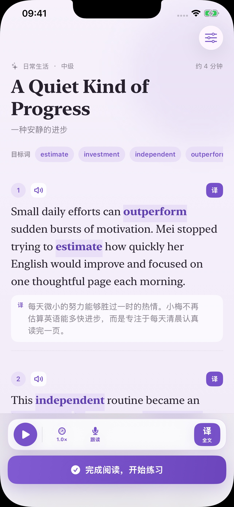
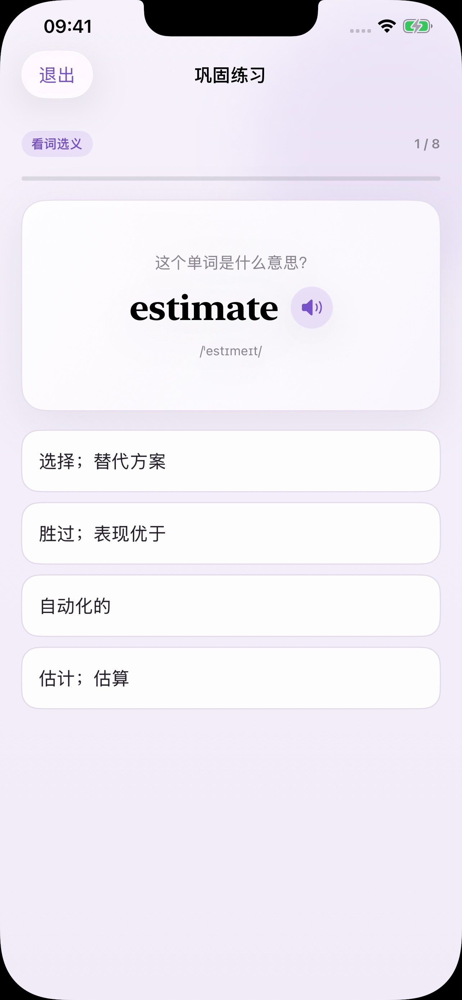
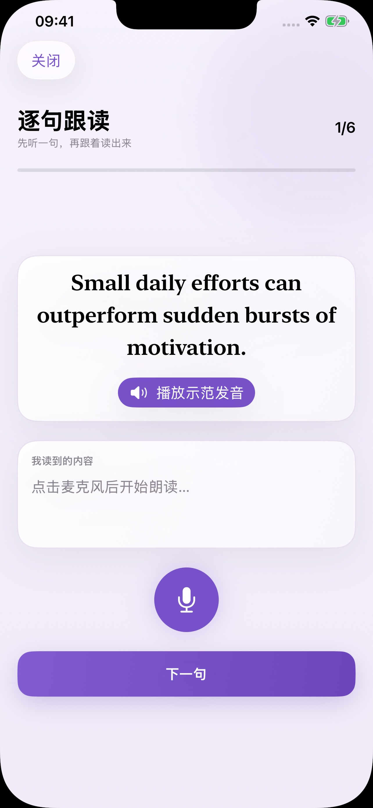
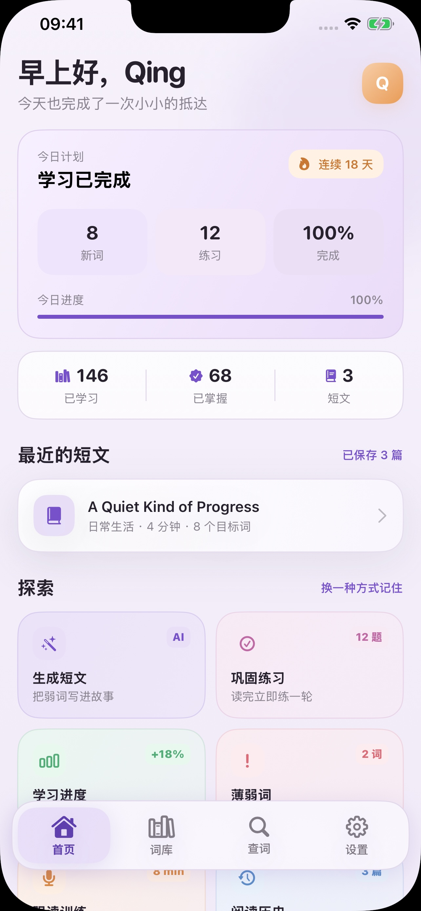
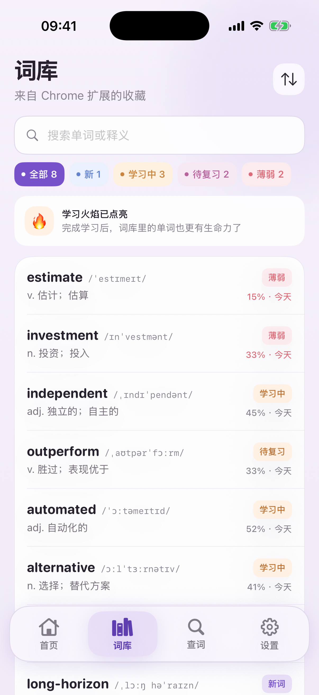
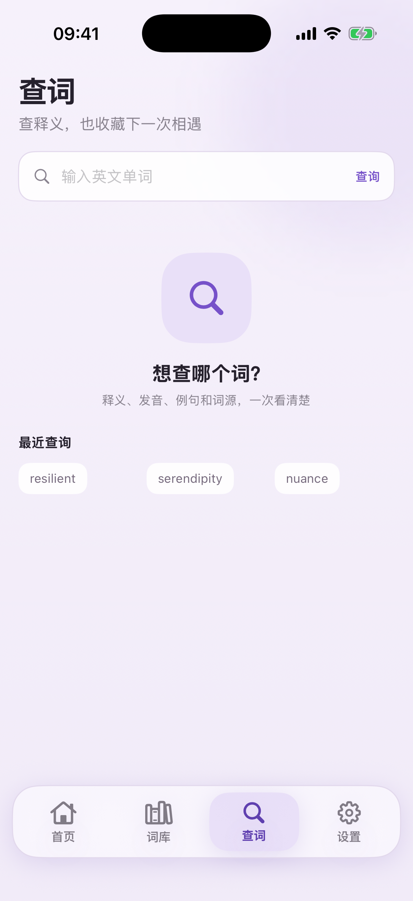
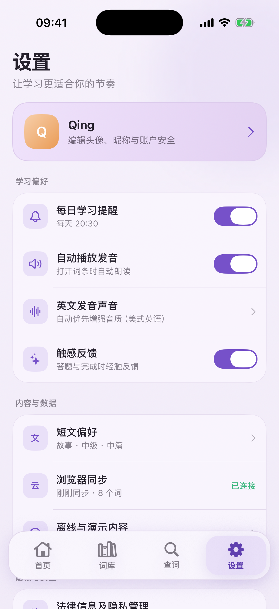

# 词鲸背单词 · CiJing

<p align="center">
  
</p>

<p align="center">
  从真实阅读中遇见的单词开始，把语境、阅读、练习与复习连成一个可持续的学习闭环。
</p>

<p align="center">
  <a href="https://apps.apple.com/cn/iphone/search?term=%E8%AF%8D%E9%B2%B8%E8%83%8C%E5%8D%95%E8%AF%8D">在 App Store 搜索词鲸背单词</a> ·
  <a href="https://chromewebstore.google.com/detail/%E8%AF%8D%E9%B2%B8%E8%83%8C%E5%8D%95%E8%AF%8D/afihhehkmefgcknloikpejfpikcddifn">安装 Chrome 扩展</a> ·
  <a href="https://github.com/KapiYue/huoci">活词微信小程序</a> ·
  <a href="README.md">English</a>
</p>

<p align="center">
  
  
  
  
  
</p>

## 产品演示

<table>
  <tr>
    <td width="50%" align="center" valign="top">
      <a href="https://youtu.be/jo6ooChwgmo">
        
      </a>
      <br><br>
      <strong>完整产品演示</strong>
      <br>
      <sub>查词收藏 → AI 分级短文 → 阅读练习 → 间隔复习</sub>
      <br><br>
      <a href="https://youtu.be/jo6ooChwgmo">▶ 点击封面观看 YouTube 演示</a>
    </td>
    <td width="50%" align="center" valign="top">
      <a href="https://chromewebstore.google.com/detail/%E8%AF%8D%E9%B2%B8%E8%83%8C%E5%8D%95%E8%AF%8D/afihhehkmefgcknloikpejfpikcddifn">
        
      </a>
      <br><br>
      <strong>词鲸 Chrome 扩展</strong>
      <br>
      <sub>双击查词 → 保留原句与来源 → 一键收藏 → 在词鲸继续学习</sub>
      <br><br>
      <a href="https://chromewebstore.google.com/detail/%E8%AF%8D%E9%B2%B8%E8%83%8C%E5%8D%95%E8%AF%8D/afihhehkmefgcknloikpejfpikcddifn">▶ 前往 Chrome Web Store 安装</a>
    </td>
  </tr>
</table>

## 为什么做它

背单词常常脱离真实阅读：查过的词散落在搜索记录中，读到的原句很快被遗忘，收藏、练习和复习又分散在不同工具里。词鲸把“遇见一个词”之后的关键动作串起来：在语境中理解它，把它保存下来，让它进入可读的内容，并在合适的时间再次遇见它。

## 核心交付

| 词鲸 iOS App | 词鲸 Chrome 扩展 | 活词微信小程序 |
| --- | --- | --- |
| 个人词库、AI 分级短文、阅读练习、逐句跟读与学习进度。 | 在网页当前语境中双击查词、听发音、保存单词及来源。 | 微信内的轻量学习入口；搜索“活词”即可使用。 |

三个入口共享核心词汇数据、语境和复习基础；每个产品仍保有适合自身场景的页面与学习编排。

## 核心体验

<p align="center">
  <a href="https://youtu.be/jo6ooChwgmo">
    
  </a>
</p>

| 1. 在语境中理解 | 2. 带着来源入库 | 3. 让词进入故事 | 4. 通过练习留下来 |
| --- | --- | --- | --- |
| 在网页双击，或在 App 内查词；查看释义、音标、发音和例句。 | 保存第一次遇见它的原句、网页来源和个人笔记。 | 从新词、薄弱词与到期词中选择，生成自然连贯的双语分级短文。 | 完成词义、语境填空、主动回忆与拼写，并由结果安排后续复习。 |

<p align="center">
  
  
  
  
</p>

## 产品界面与模块展示

| 首页 | 词库 | 查词 | 设置 |
| --- | --- | --- | --- |
| 今日计划、累计成果、已保存短文，以及继续学习的入口。 | 查看学习状态、熟练度、到期时间和每个词的语境。 | 获取释义、发音和例句，并一键收藏进词库。 | 管理学习偏好、隐私、缓存与账号。 |
|  |  |  |  |

## 多端互通，而不强行做成同一种产品

[活词](https://github.com/KapiYue/huoci) 是词鲸的微信小程序端。它与词鲸共享核心词汇数据、语境和复习基础，但针对小程序场景有自己的首启流程、每日学习编排和产品状态。

```text
词鲸 iOS App ───────┐
词鲸 Chrome 扩展 ───┼── 共享账号、词汇事实、语境与复习基础 ── Supabase
活词微信小程序 ─────┘

各端分别决定：页面体验、学习队列、产品指标与交互节奏
```

这让你既能在电脑阅读中积累真实单词，也能在 iPhone 深度阅读和练习；活词则提供微信内更轻量的每日学习入口。

## 仓库结构

```text
.
├── client/      # SwiftUI iOS App
├── extension/   # 已上架的 Chrome 查词与收藏扩展
├── supabase/    # 共享数据模型、RLS、RPC 与 Edge Functions
├── server/      # 可信 Flask 服务边界与健康检查
├── scripts/     # 配置、审计与自动化验证
├── docs/        # 公开文档、截图与演示素材
└── website/     # 隐私政策与支持页面
```

活词小程序、跨端共享类型和其小程序专属逻辑维护在独立的 [huoci](https://github.com/KapiYue/huoci) 仓库。

## 本地运行

需要 macOS、Xcode 16+、Node.js 20+、Docker Desktop 和 Chrome。复制环境变量后生成客户端配置，并启动本地 Supabase：

```bash
cp .env.example .env
# 在 .env 中填写环境变量
make config

./scripts/supabase.sh start
./scripts/supabase.sh db reset
make functions
```

用 Xcode 打开 `client/CiJing.xcodeproj`，选择 `CiJing` scheme 和 iOS 17+ 模拟器运行。开发版扩展可在 `chrome://extensions` 中选择“加载已解压的扩展程序”，然后载入 `extension/`。

## 验证与开发文档

```bash
make config-check
make extension-test
make server-test
make ios-build
```

更深入的开发、数据库和发布说明已下沉到对应文档：

- [Supabase 架构、本地开发与生产运维](supabase/README.md)
- [可信 Flask 服务](server/README.md)
- [贡献指南](CONTRIBUTING.md)
- [隐私政策](docs/privacy-policy.md)、[使用条款](docs/terms-of-service.md) 与 [支持说明](docs/support.md)

本项目采用 [MIT License](LICENSE)。安全问题请按 [SECURITY.md](SECURITY.md) 私下报告。
